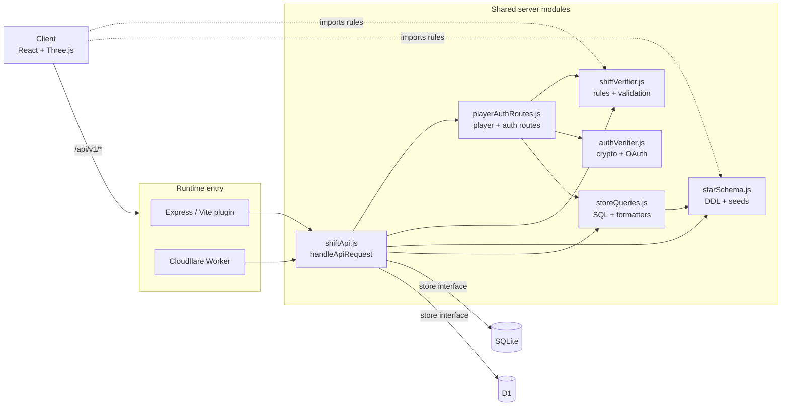

# Architecture

How idleSmoke fits together, and the constraints that aren't obvious from the file tree. The README covers setup and commands.

## Two runtimes, one rule set

The same API and game rules run in two places:

| | Local and Docker | Production and staging |
|---|---|---|
| Entry | Vite plugin (`vite.config.ts`) in dev, [`server/index.js`](../server/index.js) with `npm start` | [`server/worker.js`](../server/worker.js) |
| Store | `createSqliteStore` in [`sqliteDb.js`](../server/sqliteDb.js), using `node:sqlite` at `data/smokebreak.sqlite` | `createD1Store` in [`d1Schema.js`](../server/d1Schema.js), using Cloudflare D1 |
| Static files | Vite dev server, or Express serving `dist/` | `ASSETS` binding, with SPA fallback under `/idle-smoke` |



Each entry point does only runtime work: read a bounded body, find the client IP, call `handleApiRequest(req, store, options)`, and write the response. Routing, auth, validation and SQL live in the shared modules. The two stores implement the same interface and both run SQL from `starSchema.js` and `storeQueries.js`.

To add an endpoint, change [`shiftApi.js`](../server/shiftApi.js) (or [`playerAuthRoutes.js`](../server/playerAuthRoutes.js)), [`storeQueries.js`](../server/storeQueries.js), and both stores. Don't branch on runtime inside the handler.

## The client imports server modules

[`smokeBreak.ts`](../src/smokebreak/smokeBreak.ts) re-exports `BREAK_MS`, `PRESSES_PER_CIGARETTE`, `freshBreak` and `press` from `shiftVerifier.js`. It also re-exports `UNLOCK_THRESHOLDS` and `getUnlockedEnvironments` from `starSchema.js`. The browser therefore plays by exactly the rules the server uses to verify a shift.

Keep `shiftVerifier.js`, `authVerifier.js`, `starSchema.js`, and `storeQueries.js` free of Node-only imports. They are bundled into the client and also run in Workers, so they use Web Crypto (`globalThis.crypto`) rather than `node:crypto`.

## Shift lifecycle

1. **Start.** `POST /shifts/start` creates a `shift_fact` row with status `started` and returns a `shiftId`.
2. **Play.** The client runs a 15-second break. `recordShiftDrag` advances the `press` reducer and records each drag's millisecond offset from the first drag. Twelve drags finish a cigarette.
3. **Finish.** `POST /shifts/finish` sends `pressOffsetsMs`. The server replays them through the same `press` reducer in `verifyShiftReplay`.
4. **Record.** A valid replay becomes status `verified` and updates the player's lifetime and best counts. An invalid one is stored as `rejected`. Either way the score comes from the replay, never from client-sent totals.
5. **Respond.** The response includes the updated profile, newly unlocked environments, and the leaderboard.

Finishing an already verified shift returns the stored result, so retries are safe.

### Offline shifts

[`shiftStorage.ts`](../src/smokebreak/shiftStorage.ts) and [`shiftClient.ts`](../src/smokebreak/shiftClient.ts) queue finished shifts in platform storage and flush them later (`flushPendingShifts`). A finish call with an unknown `shiftId` is accepted only when the client also supplies `startedAt`.

## Data model

A small star schema, defined in `starSchema.js` and mirrored in [`server/schema.sql`](../server/schema.sql):

- **Dimensions:** `player_dim`, `environment_dim`, `date_dim`, `tagline_dim`.
- **Fact:** `shift_fact`, one row per shift, with `status` (`started`, `verified`, `rejected`) and `platform` (`web`, `ios`, `android`).
- **Auth:** `player_auth` maps a provider (`password`, `google`, `apple`, `session`) and its subject to a player.
- **Config:** `app_config` stores key/value settings such as tagline seeding state.

`environment_dim` is re-seeded from `ENVIRONMENT_SEEDS` every time the schema is ensured, so unlock thresholds have one source: `UNLOCK_THRESHOLDS` in `starSchema.js`. A partial index on verified shifts serves the leaderboard.

Schema creation differs by runtime:

- **SQLite:** `openSqliteDb` runs `STAR_SCHEMA_DDL` on open.
- **D1:** the Worker calls `ensureD1Schema` on the first API request and again whenever the date changes, which also inserts that day's `date_dim` row.
- **Manual init:** `npm run db:d1:init` runs `server/schema.sql` through Wrangler.

`schema.sql` and `STAR_SCHEMA_DDL` are two copies. Change both together.

## Authentication

Three ways to sign in: callsign and password, Apple, or Google. All produce the same thing, a random bearer token the client keeps in platform storage (`smokebreak.playerToken`) and sends as `Authorization: Bearer <token>`. The server stores only its hash. See [SECURITY.md](../SECURITY.md) for the controls and known limits.

## Client structure

```
App.tsx                        Holds lobby step, mode, environment, rival
└─ SmokeBreakGame.tsx          Runs a shift: input, scene, HUD, profile menu, submission
   ├─ SmokeBreakLobby.tsx      Mode deck, head-to-head matchmaking, and lobby step coordinator
   │  ├─ LobbyLoginScreen.tsx  OAuth popup/SDK helpers and universal login screen
   │  └─ CampaignSectorMap.tsx Blueprint sector map and inspector
   ├─ SmokeBreakScene.ts       Three.js scene (Cigarette.ts, Smoke.ts, textures.ts)
   ├─ SmokeBreakHud.tsx        HUD command header, brief panel, tally panel, and break report
   ├─ EnvironmentDeck.tsx      Environment definitions and picker
   └─ UserProfileMenu.tsx      Quick profile popover card and account settings modal
      └─ AdminTaglinesPanel.tsx Admin taglines CMS tab
smokeBreak.ts                  Pure game logic, no React or DOM state
shiftStorage.ts                Client types, token/profile/leaderboard cache, offline shift queue
shiftClient.ts                 Player bootstrap, offline queue flush, shift start/finish API
accountClient.ts               Callsign, password/OAuth login, sign-out, delete, taglines CMS API
styles.css + styles/*.css      Design tokens and modular stylesheets (workstation, environment-and-leaderboard, lobby-login, lobby-modes-map, account-modal, hud)
platform/                      Web vs native (Capacitor) storage and haptics
```

[`platform/`](../src/platform) is the only place that asks Capacitor which platform it's on. Everything else calls `getPlatform()`, `platformStorage` or `triggerDragHaptic()`. Storage uses `localStorage` on the web and Capacitor Preferences on native.

## Base path

Production is served under `/idle-smoke` on `idlemullet.com`, so Vite's `base` defaults to `/idle-smoke/` (`BASE_URL`). The client builds API URLs from `import.meta.env.BASE_URL`, and `normalizeApiPathname` in `shiftApi.js` strips an optional `/idle-smoke` prefix before routing, so both runtimes accept `/api/v1/*` with or without it. Browser tests run at `/`.
