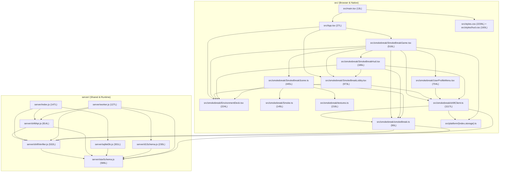

# Golden Threshold Refactoring Plan (200–400 Lines)

## 1. Objective & Guiding Principles

Bring every source file in `server/` and `src/` into the **200–400 line Golden Threshold** (or well below the 400-line soft limit where a cohesive module is naturally smaller) and every test file into the **200–600 line Golden Threshold** (600–800 soft limit, never exceeding 800 lines) while strictly preserving runtime behavior, API contracts, and score-verification integrity.

### Core Rules (`AGENTS.md` & `docs/architecture.md`)
1. **Behavior Preservation**: No feature changes or unrelated bug fixes in this refactor.
2. **Single-Sentence Responsibility**: Every new or split file must have one clear responsibility described in a single-sentence header comment at the top of the file.
3. **Browser & Cloudflare Worker Compatibility**: `server/shiftVerifier.js`, `server/authVerifier.js`, `server/starSchema.js`, and `server/storeQueries.js` must remain 100% free of Node-only APIs (`globalThis.crypto`, `TextEncoder`, `TextDecoder`, `fetch` only—never `node:crypto` or `Buffer`).
4. **No Barrel Files or Thin Wrappers**: Import symbols directly from the module that owns them.
5. **Zero Dead Exports**: Every phase must finish clean on `npm run typecheck`, `npm run knip`, and `npm run test:unit`.

---

## 2. Baseline Verification & Line Counts

### 2.1 Baseline Check Results
- **`npm run typecheck` (`tsc --noEmit`)**: **PASS** (0 errors).
- **`npm run test:unit` (`vitest run src`)**: **PASS** (5 test files, 32 tests passing).
- **`npm run knip`**: **FAIL** (2 unused exports + 1 unlisted binary warning):
  - Unused export: `CallsignBadge` in [`src/smokebreak/SmokeBreakHud.tsx`](../src/smokebreak/SmokeBreakHud.tsx#L6)
  - Unused export: `resolveRivalList` in [`src/smokebreak/SmokeBreakLobby.tsx`](../src/smokebreak/SmokeBreakLobby.tsx#L56) (used internally in `SmokeBreakLobby.tsx`, should not be exported unless consumed externally)
  - Unlisted binary: `doppler` in `vite.config.ts`

### 2.2 Baseline Source & Test Line Counts (`wc -l`)

| File | Current Lines | Status | Target Post-Split Lines |
|------|--------------:|--------|------------------------:|
| `server/shiftApi.js` | 814 | Oversized (600+) | ~390 (`shiftApi.js`) + ~370 (`playerAuthRoutes.js`) |
| `server/starSchema.js` | 586 | Soft limit (400–600) | ~215 (`starSchema.js`) + ~375 (`storeQueries.js`) |
| `server/shiftVerifier.js` | 532 | Soft limit (400–600) | ~255 (`shiftVerifier.js`) + ~280 (`authVerifier.js`) |
| `server/sqliteDb.js` | 301 | Golden (200–400) | ~305 (imports updated only) |
| `server/d1Schema.js` | 230 | Golden (200–400) | ~235 (imports updated only) |
| `server/index.js` | 147 | < 200 | 147 (unchanged) |
| `server/worker.js` | 127 | < 200 | 127 (unchanged) |
| `src/smokebreak/shiftClient.ts` | 1,117 | Oversized (600+) | ~360 (`shiftStorage.ts`) + ~360 (`shiftClient.ts`) + ~360 (`accountClient.ts`) |
| `src/smokebreak/SmokeBreakLobby.tsx` | 973 | Oversized (600+) | ~385 (`LobbyLoginScreen.tsx`) + ~205 (`CampaignSectorMap.tsx`) + ~310 (`SmokeBreakLobby.tsx`) |
| `src/smokebreak/UserProfileMenu.tsx` | 704 | Oversized (600+) | ~390 (`UserProfileMenu.tsx`) + ~260 (`AdminTaglinesPanel.tsx`) |
| `src/smokebreak/SmokeBreakGame.tsx` | 516 | Soft limit (400–600) | ~380 (`SmokeBreakGame.tsx`) |
| `src/smokebreak/SmokeBreakHud.tsx` | 186 | < 200 (has dead export) | ~230 (`SmokeBreakHud.tsx`) |
| `src/smokebreak/SmokeBreakScene.ts` | 445 | Soft limit (400–600) | ~345 (`SmokeBreakScene.ts`) + ~115 (`Cigarette.ts`) |
| `src/smokebreak/EnvironmentDeck.tsx` | 224 | Golden (200–400) | 224 (unchanged) |
| `src/smokebreak/textures.ts` | 216 | Golden (200–400) | 216 (unchanged) |
| `src/smokebreak/Smoke.ts` | 145 | < 200 | 145 (unchanged) |
| `src/smokebreak/smokeBreak.ts` | 90 | < 200 | 90 (unchanged) |
| `src/styles.css` | 2,239 | Oversized (600+) | ~320 (`src/styles.css`) + 6 modular stylesheets in `src/styles/` |
| `src/styles/hud.css` | 160 | < 200 | ~377 (`src/styles/hud.css`) |
| `src/smokebreak/shiftApi.test.ts` | 1,132 | Oversized test (800+) | ~560 (`shiftApi.test.ts`) + ~580 (`playerAuthAndAdmin.test.ts`) |
| `src/smokebreak/shiftClient.test.ts` | 380 | Golden test (200–600) | 380 (imports updated only) |
| `src/smokebreak/starSchema.test.ts` | 362 | Golden test (200–600) | 362 (imports updated only) |
| `src/platform/platform.test.ts` | 173 | < 200 test | 173 (unchanged) |
| `src/smokebreak/smokeBreak.test.ts` | 75 | < 200 test | 75 (unchanged) |

---

## 3. Complete Dependency Map (`server/` and `src/`)

### 3.1 Current Dependency Graph

### 3.2 External Importers of Target Files

1. **`server/starSchema.js`** is imported by:
   - `server/shiftVerifier.js` (`ENVIRONMENT_SEEDS`)
   - `server/shiftApi.js` (`VALID_TAGLINE_CADENCES`, `formatPlayerProfile`, `getUnlockedEnvironments`, `isEmailInAdminList`)
   - `server/sqliteDb.js` (DDL, seeds, `buildDateDimRow`, plus `API_SQL`, `INSPECT_QUERIES`, write plans, and row formatters)
   - `server/d1Schema.js` (DDL, seeds, `buildDateDimRow`, plus `API_SQL`, `INSPECT_QUERIES`, write plans, and row formatters)
   - `server/worker.js` (`buildDateDimRow`)
   - `src/smokebreak/smokeBreak.ts` (`UNLOCK_THRESHOLDS`, `getUnlockedEnvironments`)
   - `scripts/db-inspect.mjs` (`INSPECT_QUERIES`, `formatInspectReport`, `normalizeInspectSummary`)
   - `src/smokebreak/starSchema.test.ts` (`UNLOCK_THRESHOLDS`, `buildDateDimRow`, `formatInspectReport`, `getUnlockedEnvironments`)
2. **`server/shiftVerifier.js`** is imported by:
   - `server/shiftApi.js` (constants, validators, replay verifier, and auth crypto helpers)
   - `server/index.js` (`MAX_BODY_BYTES`)
   - `server/worker.js` (`MAX_BODY_BYTES`)
   - `src/smokebreak/smokeBreak.ts` (`BREAK_MS`, `PRESSES_PER_CIGARETTE`, `freshBreak`, `press`, `SmokeBreakState`)
   - `src/smokebreak/shiftClient.ts` (`normalizeStartedAtUnix`, `verifyShiftReplay`)
   - `src/smokebreak/shiftApi.test.ts` (`hashPlayerToken`)
3. **`server/shiftApi.js`** is imported by:
   - `server/index.js` (`handleApiRequest`, `isApiPathname`)
   - `server/worker.js` (`handleApiRequest`, `isApiPathname`)
   - `src/smokebreak/shiftApi.test.ts` (`handleApiRequest`)
   - `src/smokebreak/shiftClient.test.ts` (`handleApiRequest`)
4. **`src/smokebreak/shiftClient.ts`** is imported by:
   - `src/smokebreak/SmokeBreakGame.tsx`
   - `src/smokebreak/SmokeBreakLobby.tsx`
   - `src/smokebreak/SmokeBreakHud.tsx`
   - `src/smokebreak/UserProfileMenu.tsx`
   - `src/smokebreak/shiftClient.test.ts`
5. **`src/smokebreak/SmokeBreakLobby.tsx`** is imported by:
   - `src/App.tsx` (`GameModeId`, `LobbyStep`, `RivalOpponent`)
   - `src/smokebreak/SmokeBreakGame.tsx` (`SmokeBreakLobby`, `GameModeId`, `LobbyStep`, `RivalOpponent`)
   - `src/smokebreak/SmokeBreakHud.tsx` (`GameModeId`, `RivalOpponent`)
6. **`src/smokebreak/UserProfileMenu.tsx`** is imported by:
   - `src/smokebreak/SmokeBreakGame.tsx` (`AccountSettingsModal`, `UserCircleTrigger`)
7. **`src/smokebreak/SmokeBreakHud.tsx`** is imported by:
   - `src/smokebreak/SmokeBreakGame.tsx` (`BreakReportDialog`, plus newly extracted HUD panels)
8. **`src/smokebreak/SmokeBreakScene.ts`** is imported by:
   - `src/smokebreak/SmokeBreakGame.tsx` (`SmokeBreakScene`)
9. **`src/styles.css`** is imported by:
   - `src/main.tsx` (`import './styles.css'`)

---

## 4. Detailed Split Specifications (All 9 Targets)

### Split 1: `server/starSchema.js` (586 lines) → `server/starSchema.js` (~215 lines) + `server/storeQueries.js` (~375 lines)

- **`server/starSchema.js` (~215 lines)**
  - **Header comment**: `// Star schema DDL, SQLite pragmas, environment unlock thresholds, seed data, and date-dimension key builder.`
  - **Retains**:
    - `UNLOCK_THRESHOLDS`
    - `ENVIRONMENT_SEEDS`
    - `getUnlockedEnvironments`
    - `SQLITE_PRAGMA_STATEMENTS`
    - `STAR_SCHEMA_DDL`
    - `DEFAULT_TAGLINE_CADENCE`
    - `VALID_TAGLINE_CADENCES`
    - `TAGLINE_SEEDS`
    - `SEED_TAGLINE_IF_INITIAL_SQL`
    - `MARK_TAGLINES_SEEDED_SQL`
    - `ENSURE_DEFAULT_CADENCE_SQL`
    - `UPSERT_ENVIRONMENT_DIM_SQL`
    - `INSERT_DATE_DIM_SQL`
    - `buildDateDimRow`
- **`server/storeQueries.js` (~375 lines) [NEW]**
  - **Header comment**: `// Shared SQL queries, shift write-plan builders, and row formatters for SQLite and Cloudflare D1 stores.`
  - **Imports**: `{ buildDateDimRow, getUnlockedEnvironments }` from `./starSchema.js`
  - **Moves in**:
    - `INSPECT_QUERIES`
    - `normalizeInspectSummary`
    - `formatInspectReport`
    - `API_SQL`
    - `buildVerifiedShiftWritePlan`
    - `buildRejectedShiftWritePlan`
    - `isEmailInAdminList`
    - `formatPlayerProfile`
    - `formatTaglineRow`
    - `formatLeaderboardResponse`
- **Import Updates**:
  - `server/sqliteDb.js`: Import schema/seed constants and `buildDateDimRow` from `./starSchema.js`; import `API_SQL`, `INSPECT_QUERIES`, `buildRejectedShiftWritePlan`, `buildVerifiedShiftWritePlan`, `formatLeaderboardResponse`, `formatTaglineRow`, `normalizeInspectSummary` from `./storeQueries.js`.
  - `server/d1Schema.js`: Same split of imports between `./starSchema.js` and `./storeQueries.js`.
  - `server/shiftApi.js` (and `server/playerAuthRoutes.js`): Import `VALID_TAGLINE_CADENCES`, `getUnlockedEnvironments` from `./starSchema.js`; import `formatPlayerProfile`, `isEmailInAdminList` from `./storeQueries.js`.
  - `scripts/db-inspect.mjs`: Import `INSPECT_QUERIES`, `formatInspectReport`, `normalizeInspectSummary` from `../server/storeQueries.js`.
  - `src/smokebreak/starSchema.test.ts`: Import `formatInspectReport` from `../../server/storeQueries.js` and keep `UNLOCK_THRESHOLDS`, `buildDateDimRow`, `getUnlockedEnvironments` from `../../server/starSchema.js`.

---

### Split 2: `server/shiftVerifier.js` (532 lines) → `server/shiftVerifier.js` (~255 lines) + `server/authVerifier.js` (~280 lines)

- **`server/shiftVerifier.js` (~255 lines)**
  - **Header comment**: `// Deterministic shift press reducer, replay anti-cheat verifier, request rate limiter, and input validators.`
  - **Imports**: `{ ENVIRONMENT_SEEDS }` from `./starSchema.js`
  - **Retains**:
    - Constants: `BREAK_MS`, `PRESSES_PER_CIGARETTE`, `MAX_BODY_BYTES`, internal rate-limit and validation constants
    - Types: `SmokeBreakState` typedef
    - Functions: `freshBreak`, `press`, `checkRateLimit`, `validateCallsign`, `validateLoginIdentifier`, `validatePassword`, `normalizePlatform`, `isValidEnvironmentId`, `hasTamperedScoreFields`, `normalizeStartedAtUnix`, `verifyShiftReplay`
- **`server/authVerifier.js` (~280 lines) [NEW]**
  - **Header comment**: `// Web Crypto token hashing, credential generation, PBKDF2 password hashing, and OAuth JWKS ID token verification.`
  - **Imports**: None (uses standard Web APIs `globalThis.crypto`, `TextEncoder`, `TextDecoder`, `globalThis.atob`, `globalThis.fetch`)
  - **Moves in**:
    - `hashPlayerToken`
    - `generatePlayerCredentials`
    - `extractBearerToken`
    - `PBKDF2_ITERATIONS`, `hashPassword`, `verifyPassword`
    - `OAUTH_PROVIDERS`, `decodeBase64UrlBytes`, `deriveCallsignFromClaims`, `verifyOAuthIdToken`
- **Import Updates**:
  - `server/shiftApi.js` & `server/playerAuthRoutes.js`: Import shift/validation functions from `./shiftVerifier.js` and auth/crypto functions from `./authVerifier.js`.
  - `src/smokebreak/shiftApi.test.ts`: Update `hashPlayerToken` import to `../../server/authVerifier.js`.
  - `src/smokebreak/smokeBreak.ts`, `src/smokebreak/shiftClient.ts` (`shiftStorage.ts`), `server/index.js`, `server/worker.js`: Continue importing from `./shiftVerifier.js` (no change needed).

---

### Split 3: `server/shiftApi.js` (814 lines) → `server/shiftApi.js` (~390 lines) + `server/playerAuthRoutes.js` (~370 lines)

- **`server/playerAuthRoutes.js` (~370 lines) [NEW]**
  - **Header comment**: `// Player profile, session authentication, password login, and OAuth route handlers for the v1 API.`
  - **Imports**:
    - `{ formatPlayerProfile, isEmailInAdminList }` from `./storeQueries.js`
    - `{ normalizePlatform, validateCallsign, validateLoginIdentifier, validatePassword }` from `./shiftVerifier.js`
    - `{ extractBearerToken, generatePlayerCredentials, hashPassword, hashPlayerToken, verifyOAuthIdToken, verifyPassword }` from `./authVerifier.js`
  - **Moves in**:
    - `authenticatePlayer(authHeader, store)` (exported)
    - `authenticateAdmin(req, store, options)` (exported)
    - `handlePlayerAndAuthRoutes({ method, route, req, body, store, nowUnix, rawAdminEmails, options })` (exported), handling:
      - `GET /api/v1/players/me` (Note: invoked before body parsing or with parsed body; see routing order below)
      - `DELETE /api/v1/players/me`
      - `POST /api/v1/players`
      - `PATCH /api/v1/players/me`
      - `POST /api/v1/auth/login`
      - `POST /api/v1/auth/oauth`
    - Returns `{ status, body }` when `route` matches a player/auth endpoint, or `null` when unmatched so `handleApiRequest` continues.
    - **Order of operations note**: In current `handleApiRequest`, `GET /api/v1/players/me` and `DELETE /api/v1/players/me` execute before `parseJsonObjectBody(req.rawBody)` and `hasTamperedScoreFields(body)`. Preserve this exact order by either:
      1. Parsing JSON body and checking `hasTamperedScoreFields(body)` right after the `GET`/`DELETE` `/api/v1/players/me` check (or passing `body` for `POST`/`PATCH` routes), OR
      2. Keeping `parseJsonObjectBody` + `hasTamperedScoreFields` in `shiftApi.js` right after `GET`/`DELETE` checks, or passing a lazy/pre-parsed body into `handlePlayerAndAuthRoutes` after `parseJsonObjectBody` (since `GET` and `DELETE` requests in tests/clients have empty/undefined `rawBody` which `parseJsonObjectBody` returns `{ ok: true, value: {} }` for). Verify against all 9 test suites in `src/smokebreak/shiftApi.test.ts`.
- **`server/shiftApi.js` (~390 lines)**
  - **Header comment**: `// Server-authoritative v1 API router for leaderboard, taglines CMS, and shift start/finish verification.`
  - **Imports**:
    - `{ VALID_TAGLINE_CADENCES, getUnlockedEnvironments }` from `./starSchema.js`
    - `{ formatPlayerProfile }` from `./storeQueries.js`
    - `{ MAX_BODY_BYTES, checkRateLimit, hasTamperedScoreFields, isValidEnvironmentId, normalizePlatform, normalizeStartedAtUnix, verifyShiftReplay }` from `./shiftVerifier.js`
    - `{ authenticateAdmin, authenticatePlayer, handlePlayerAndAuthRoutes }` from `./playerAuthRoutes.js`
  - **Retains**:
    - `normalizeApiPathname`, `isApiPathname`, `parseJsonObjectBody`, `normalizeJokeCandidates`, `authenticateAndValidateShiftContext`
    - `handleApiRequest(req, store, options)` covering rate-limit & payload-size guards, `/api/v1/leaderboard`, `/api/v1/taglines`, `/api/v1/admin/taglines` (`GET`, `POST`, `PATCH`, `DELETE`), delegation to `handlePlayerAndAuthRoutes`, `/api/v1/shifts/start`, `/api/v1/shifts/finish`, and `404` fallback.
- **Import Updates**:
  - `server/index.js`, `server/worker.js`, `src/smokebreak/shiftApi.test.ts`, and `src/smokebreak/shiftClient.test.ts` all continue importing `{ handleApiRequest, isApiPathname }` from `server/shiftApi.js`.

---

### Split 4: `src/smokebreak/shiftClient.ts` (1,117 lines) → `src/smokebreak/shiftStorage.ts` (~360 lines) + `src/smokebreak/shiftClient.ts` (~360 lines) + `src/smokebreak/accountClient.ts` (~360 lines)

- **`src/smokebreak/shiftStorage.ts` (~360 lines) [NEW]**
  - **Header comment**: `// Client-side types, platform storage hydration, profile/leaderboard caches, and offline shift queue persistence.`
  - **Moves in**:
    - Exported types: `AuthProviderId`, `TaglineCadence`, `TaglineItem`, `TaglineCollection`, `PlayerProfile`, `LeaderboardEntry`, `LeaderboardResponse`, `StartedShiftSession`, `PendingShift`, `ShiftFinishResult`, `FetchLike`
    - Storage keys & defaults: `TOKEN_STORAGE_KEY`, `PROFILE_STORAGE_KEY`, `PENDING_SHIFTS_STORAGE_KEY`, `DEFAULT_PROFILE`, `EMPTY_LEADERBOARD`
    - State & cache helpers (exported where needed by `shiftClient.ts`, `accountClient.ts`, or tests):
      - `hydrateNativeStorage`
      - `getStoredToken`, `setStoredToken`, `clearStoredToken`
      - `normalizeProfile`, `getCachedPlayerProfile`, `setCachedProfile`, `clearCachedProfile` (or reset helper)
      - `getCachedLeaderboard`, `setCachedLeaderboard`
      - `resolveStartedAtUnix`, `readPendingShiftsFromStorage`, `writePendingShiftsToStorage`, `getPendingShifts`, `clearPendingShifts`
      - `createRejectedShiftResult`, `enqueueOfflineShift`
      - `resolveShiftEnvironment`, `resolveApiPath`
      - `resetShiftClientStateForTests`
- **`src/smokebreak/shiftClient.ts` (~360 lines)**
  - **Header comment**: `// Shift session lifecycle client: player bootstrap, offline queue flushing, shift start, and finished shift submission.`
  - **Retains**:
    - `fetchLeaderboard` (internal or exported for `bootstrapPlayerSession`)
    - `ensureAuthenticatedPlayer` (exported for `accountClient.ts`)
    - `flushPendingShifts`
    - `bootstrapPlayerSession`
    - `startShiftSession`
    - `submitFinishedShift`
- **`src/smokebreak/accountClient.ts` (~360 lines) [NEW]**
  - **Header comment**: `// Account management, password/OAuth sign-in, session sign-out, account deletion, and taglines CMS client.`
  - **Imports**: Storage/API helpers from `./shiftStorage` and `{ bootstrapPlayerSession, ensureAuthenticatedPlayer }` from `./shiftClient`
  - **Moves in**:
    - `updatePlayerCallsign`
    - `loginWithPassword`
    - `loginWithOAuth`
    - `signOutPlayerSession`
    - `deletePlayerAccount`
    - `FALLBACK_TAGLINES`
    - `formatWhereTagline`
    - `buildAdminHeaders`
    - `fetchActiveTaglines`
    - `fetchAdminTaglines`
    - `addAdminTaglines`
    - `updateAdminTagline`
    - `deleteAdminTagline`
- **Import Updates**:
  - `src/smokebreak/SmokeBreakGame.tsx`:
    - From `./shiftStorage`: `getCachedLeaderboard`, `getCachedPlayerProfile`, `resolveShiftEnvironment`, types `LeaderboardEntry`, `LeaderboardResponse`, `PlayerProfile`, `ShiftFinishResult`, `StartedShiftSession`, `TaglineCadence`, `TaglineItem`
    - From `./shiftClient`: `bootstrapPlayerSession`, `flushPendingShifts`, `startShiftSession`, `submitFinishedShift`
    - From `./accountClient`: `FALLBACK_TAGLINES`, `deletePlayerAccount`, `fetchActiveTaglines`, `formatWhereTagline`, `loginWithOAuth`, `loginWithPassword`, `signOutPlayerSession`, `updatePlayerCallsign`
  - `src/smokebreak/SmokeBreakLobby.tsx` (and split lobby files): Import `type LeaderboardEntry, type PlayerProfile` from `./shiftStorage`.
  - `src/smokebreak/SmokeBreakHud.tsx`: Import `type LeaderboardEntry, type PlayerProfile` from `./shiftStorage` and `formatWhereTagline, type TaglineItem` from `./accountClient` (or `./shiftStorage` for types).
  - `src/smokebreak/UserProfileMenu.tsx` & `src/smokebreak/AdminTaglinesPanel.tsx`: Import admin tagline functions from `./accountClient` and types (`AuthProviderId`, `PlayerProfile`, `TaglineCadence`, `TaglineCollection`, `TaglineItem`) from `./shiftStorage`.
  - `src/smokebreak/shiftClient.test.ts`: Import storage helpers (`getCachedPlayerProfile`, `getPendingShifts`, `resetShiftClientStateForTests`) from `./shiftStorage`, shift lifecycle functions (`bootstrapPlayerSession`, `flushPendingShifts`, `startShiftSession`, `submitFinishedShift`) from `./shiftClient`, and account functions (`deletePlayerAccount`, `loginWithPassword`, `signOutPlayerSession`, `updatePlayerCallsign`) from `./accountClient`.
  - **Knip check**: Ensure no unused re-exports exist across `shiftStorage.ts`, `shiftClient.ts`, and `accountClient.ts`. Only export functions/types from the module that defines them.

---

### Split 5: `src/smokebreak/SmokeBreakLobby.tsx` (973 lines) → `src/smokebreak/LobbyLoginScreen.tsx` (~385 lines) + `src/smokebreak/CampaignSectorMap.tsx` (~205 lines) + `src/smokebreak/SmokeBreakLobby.tsx` (~310 lines)

- **`src/smokebreak/LobbyLoginScreen.tsx` (~385 lines) [NEW]**
  - **Header comment**: `// Universal account sign-in screen supporting Apple ID, Google OAuth popup flow, and callsign/email password auth.`
  - **Moves in**:
    - `AppleAuthWindow` interface
    - `loadExternalScript`
    - `requestAppleIdToken`
    - `requestGoogleIdTokenPopup`
    - `LoginScreen` (exported component)
- **`src/smokebreak/CampaignSectorMap.tsx` (~205 lines) [NEW]**
  - **Header comment**: `// Interactive blueprint sector map and environment inspector for Campaign mode.`
  - **Moves in**:
    - `MAP_COORDS`
    - `CampaignSectorMap` (exported component)
- **`src/smokebreak/SmokeBreakLobby.tsx` (~310 lines)**
  - **Header comment**: `// Multi-step pre-shift lobby coordinator, 3-card game mode deck, and 1v1 head-to-head matchmaking screen.`
  - **Retains**:
    - Exported types: `LobbyStep`, `GameModeId`, `RivalOpponent`, `SmokeBreakLobbyProps`
    - Internal constant & helper: `DEFAULT_RIVALS`, `resolveRivalList` (**Note**: remove `export` keyword from `resolveRivalList` to resolve the baseline `knip` unused export failure!)
    - Components: `GameModeDeck`, `HeadToHeadLobby`, `SmokeBreakLobby` (exported)
- **Import Updates**:
  - `src/App.tsx`, `src/smokebreak/SmokeBreakGame.tsx`, and `src/smokebreak/SmokeBreakHud.tsx` continue importing `SmokeBreakLobby`, `GameModeId`, `LobbyStep`, `RivalOpponent` from `./SmokeBreakLobby`.

---

### Split 6: `src/smokebreak/UserProfileMenu.tsx` (704 lines) → `src/smokebreak/UserProfileMenu.tsx` (~390 lines) + `src/smokebreak/AdminTaglinesPanel.tsx` (~260 lines)

- **`src/smokebreak/AdminTaglinesPanel.tsx` (~260 lines) [NEW]**
  - **Header comment**: `// Admin taglines CMS panel for rotating cadence, bulk-importing jokes, and toggling or deleting taglines.`
  - **Imports**: `{ addAdminTaglines, deleteAdminTagline, fetchAdminTaglines, updateAdminTagline }` from `./accountClient` and `{ type PlayerProfile, type TaglineCadence, type TaglineCollection, type TaglineItem }` from `./shiftStorage`
  - **Moves in**:
    - `ADMIN_PASSCODE_SESSION_KEY`
    - `CADENCE_OPTIONS`
    - `AdminTaglinesPanel` component (encapsulating `adminPasscode`, `passcodeInput`, `adminUnlocked`, `adminBusy`, `adminError`, `adminNotice`, `adminCadence`, `adminTaglines`, `newJokesDraft`, `useEffect` fetch on mount, `submitAdminPasscode`, `handleCadenceChange`, `handleAddJokes`, `handleToggleJoke`, `handleDeleteJoke`, and the admin tab JSX)
- **`src/smokebreak/UserProfileMenu.tsx` (~390 lines)**
  - **Header comment**: `// Top-right user avatar trigger, quick profile popover card, and account settings modal.`
  - **Imports**: `{ AdminTaglinesPanel }` from `./AdminTaglinesPanel` and `{ type AuthProviderId, type PlayerProfile, type TaglineCollection }` from `./shiftStorage`
  - **Retains**:
    - `PROVIDER_DISPLAY`, `getInitials`
    - `UserCircleTrigger` (exported)
    - `AccountSettingsModal` (exported; renders `<AdminTaglinesPanel profile={profile} onTaglinesUpdated={onTaglinesUpdated} />` when `activeTab === 'admin'`)
- **Import Updates**:
  - `src/smokebreak/SmokeBreakGame.tsx` continues importing `{ AccountSettingsModal, UserCircleTrigger }` from `./UserProfileMenu`.

---

### Split 7: `src/smokebreak/SmokeBreakGame.tsx` (516 lines) & `src/smokebreak/SmokeBreakHud.tsx` (186 lines) → `src/smokebreak/SmokeBreakGame.tsx` (~380 lines) + `src/smokebreak/SmokeBreakHud.tsx` (~230 lines)

- **`src/smokebreak/SmokeBreakHud.tsx` (~230 lines)**
  - **Header comment**: `// Heads-up display panels for active smoke breaks: top command bar, brief instructions, butt tally, and post-shift report dialog.`
  - **Removes**:
    - Unused `CallsignBadge` component (lines 6–74), fixing the `knip` unused export failure.
  - **Moves in from `SmokeBreakGame.tsx`**:
    - `SmokeCommandHeader`: Renders `<header className="hud-command hud-panel" ...>` with brand eyebrow, rotating `formatWhereTagline(activeTagline.jokeText)` tagline, `shift-clock` timer, and `<UserCircleTrigger ... />`.
    - `SmokeBriefPanel`: Renders `<section className="hud-panel smoke-brief">...</section>` with break duration, status heading, and touch vs keyboard drag instructions.
    - `SmokeTallyPanel`: Renders `<section className="hud-panel smoke-tally" aria-label="Smoke break tally">...</section>` with butts count, current cigarette meter, break time left meter, and career/H2H stats strip.
  - **Retains**:
    - `BreakReportDialog`
- **`src/smokebreak/SmokeBreakGame.tsx` (~380 lines)**
  - **Header comment**: `// Top-level Smoke Break game controller managing shift state, 3D scene lifecycle, input handlers, and HUD/lobby overlays.`
  - **Replaces inline JSX** for the command header, brief panel, and tally panel with `<SmokeCommandHeader />`, `<SmokeBriefPanel />`, and `<SmokeTallyPanel />` imported from `./SmokeBreakHud`.

---

### Split 8: `src/smokebreak/SmokeBreakScene.ts` (445 lines) → `src/smokebreak/SmokeBreakScene.ts` (~345 lines) + `src/smokebreak/Cigarette.ts` (~115 lines)

- **`src/smokebreak/Cigarette.ts` (~115 lines) [NEW]**
  - **Header comment**: `// 3D cigarette mesh assembly, burning rod/ash geometry updates, ember glow flicker, and stubbed-out butt factory.`
  - **Moves in**:
    - Cigarette dimension constants: `RADIUS = 0.39`, `FILTER = 2.7`, `ROD = 5.7`, `STUB = 0.8`, `BURNABLE = ROD - STUB`, `CHAR = 0.14`, `EMBER = 0.16`
    - `Materials` interface (exported)
    - `Cigarette` class (exported)
    - `makeButt(materials: Materials)` function (exported)
- **`src/smokebreak/SmokeBreakScene.ts` (~345 lines)**
  - **Header comment**: `// Three.js smoke break scene: steel ashtray, environment lighting, sidestream/exhale smoke particles, and falling ash/butt animations.`
  - **Imports**: `{ BURNABLE, Cigarette, FILTER, type Materials, RADIUS, ROD, STUB, makeButt }` from `./Cigarette`
  - **Retains**:
    - Scene placement constants (`BED_Y`, `BED_RADIUS`, `UP`, `TIP`, `AXIS`, `Pose`, `ease`)
    - `SmokeBreakScene` class (exported)

---

### Split 9: `src/styles.css` (2,239 lines) & `src/styles/hud.css` (160 lines) → 7 Modular Stylesheets (All 280–365 Lines)

Split `src/styles.css` along its 6 section banners and consolidate HUD rules with `src/styles/hud.css`:

1. **`src/styles.css` (~320 lines)**
   - **Header comment**: `/* Design tokens, base typography/reset rules, reusable style-guide components, and stylesheet imports. */`
   - **Contents**: Lines 1–320 of `src/styles.css` (`:root` variables, element resets, `.status-badge`, `.status-dot`, `.hud-card`, `.btn-*`, `.tooltip-*`).
   - **Imports**: Either `@import` the modular stylesheets at the top/bottom of `src/styles.css` or import them explicitly in `src/main.tsx` in exact cascade order:
     1. `./styles.css`
     2. `./styles/workstation.css`
     3. `./styles/environment-and-leaderboard.css`
     4. `./styles/hud.css`
     5. `./styles/lobby-login.css`
     6. `./styles/lobby-modes-map.css`
     7. `./styles/account-modal.css`
2. **`src/styles/workstation.css` (~320 lines) [NEW]**
   - **Header comment**: `/* Workstation shell, shift controls, conveyor telemetry, and core smoke-break viewport layout. */`
   - **Contents**: Lines 321–640 of `src/styles.css` (`Application Specific Workstation & Layout`, `.smoke-break`, `.smoke-viewport`, `.smoke-brief`, `.smoke-tally`, `.smoke-result`, and responsive/reduced-motion media queries).
3. **`src/styles/environment-and-leaderboard.css` (~362 lines) [NEW]**
   - **Header comment**: `/* Environment backdrop, collapsible 4-spot filmstrip deck, break report stats, and top-10 leaderboard styles. */`
   - **Contents**: Lines 641–1002 of `src/styles.css` (`Smoke Break Environment Backdrop & Filmstrip Deck`, `.env-*`, `.hud-command`, `.callsign-*`, `.smoke-tally-career`, `.break-report-stats`, `.unlock-banner`, `.leaderboard-*`, `.smoke-result-actions`).
4. **`src/styles/hud.css` (~295 lines)**
   - **Header comment**: `/* Heads-up display panels, top bar brand/tagline, and quick user profile popover card styles. */`
   - **Contents**: Existing `src/styles/hud.css` (160 lines) + Top-Right User Avatar Circle & Option C Quick Profile Card Popover + HUD brand/tagline rules from `src/styles.css` (lines 1613–1855 and lines 2089–2113, ~135–240 lines; if keeping all 243 lines of Avatar+QuickCard + 25 lines of `.hud-brand`/`.hud-tagline`, move the legacy compact/drawer rules or split cleanly at line 1779 so `src/styles/hud.css` is ~295 lines and `src/styles/account-modal.css` is ~358 lines).
   - **Exact boundary option to hit ~295L and ~358L**:
     - Move lines 1613–1778 (Avatar Circle button + `.proto-mobbin-*` header/stats strip, 166 lines) or lines 1613–1855 (243 lines) into `src/styles/hud.css` / `src/styles/account-modal.css` such that:
       - `src/styles/hud.css` = existing 160 lines + lines 1613–1742 (or 1613–1778 + 2089–2113) ≈ **295–350 lines**.
       - `src/styles/account-modal.css` = remaining Option C/Option B Account Settings Modal & Admin Taglines rules (lines 1779–2239 or 1856–2239) ≈ **358–384 lines**.
     - Both files land squarely in the **200–400 line Golden Threshold** while preserving the exact CSS rule order.
5. **`src/styles/lobby-login.css` (~283 lines) [NEW]**
   - **Header comment**: `/* Pre-shift lobby overlay primitives, SSO buttons, auth mode tabs, and login form styles. */`
   - **Contents**: Lines 1003–1285 of `src/styles.css` (`.proto-overlay`, `.proto-chip`, `.proto-a-card`, `.proto-step-indicator`, `.proto-sso-*`, `.proto-auth-*`, `.proto-login-*`, `.proto-spot-pill`, `.proto-a-stats-row`).
6. **`src/styles/lobby-modes-map.css` (~327 lines) [NEW]**
   - **Header comment**: `/* 3-card game mode deck, interactive blueprint sector map, and 1v1 head-to-head matchmaking lobby styles. */`
   - **Contents**: Lines 1286–1612 of `src/styles.css` (`--- 3-Card Mode Deck & Blueprint Sector Map ---`, `.proto-map-*`, `.proto-mode-*`, `.proto-blueprint-*`, `.proto-pin-*`, `.proto-inspector-*`, `--- Head-to-Head 1v1 Lobby ---`, `.proto-h2h-*`, `.proto-fighter-card`).
7. **`src/styles/account-modal.css` (~358 lines) [NEW]**
   - **Header comment**: `/* Quick profile popover card, 3-tab account settings modal, danger zone confirmation, and admin taglines CMS styles. */`
   - **Contents**: Option B Account Settings Modal & Admin Tagline CMS rules from `src/styles.css` (lines 1856–2088 and 2114–2239, plus `.proto-discord-*` if placed here, totaling ~358–384 lines).

---

### Split 10: `src/smokebreak/shiftApi.test.ts` (1,132 lines) → `src/smokebreak/shiftApi.test.ts` (~560 lines) + `src/smokebreak/playerAuthAndAdmin.test.ts` (~580 lines)

**Current responsibilities mixed in `src/smokebreak/shiftApi.test.ts`**:
1. Shift verification, `/api/shifts` HTTP routes, leaderboard pagination, rival lookups, and campaign progress tests.
2. Player registration, password login, SSO login, session management, account profile mutations, and admin tagline CMS route tests.

**Proposed split**:
1. **`src/smokebreak/shiftApi.test.ts` (~560 lines)**
   - **Header comment**: `// Unit and integration tests for shift verification, /api/shifts endpoints, leaderboards, and campaign progress.`
   - **Remains in `src/smokebreak/shiftApi.test.ts`**: Shift replay verification tests, `/api/shifts` POST/GET integration tests, rival and leaderboard filtering tests, and campaign sector progression tests.
2. **`src/smokebreak/playerAuthAndAdmin.test.ts` (~580 lines) [NEW]**
   - **Header comment**: `// Integration tests for player auth, SSO login, account management, and admin tagline CMS routes.`
   - **Moves to `src/smokebreak/playerAuthAndAdmin.test.ts`**: Player registration, password & SSO login, session token validation, account profile/password/deletion routes, and `/api/admin/taglines` + `/api/taglines` route tests.

---

## 5. Subagent Execution Sequence & Verification Gates

To prevent merge conflicts and broken intermediate states, execute the refactor in **4 sequential waves** (or isolated subagent ownership boundaries) with a mandatory verification gate after each wave:

### Wave 1: Server Module Splits (Splits 1, 2, 3)
1. Split `server/starSchema.js` → `server/starSchema.js` + `server/storeQueries.js`. Update `server/sqliteDb.js`, `server/d1Schema.js`, `scripts/db-inspect.mjs`, `src/smokebreak/starSchema.test.ts`.
2. Split `server/shiftVerifier.js` → `server/shiftVerifier.js` + `server/authVerifier.js`. Update `src/smokebreak/shiftApi.test.ts`.
3. Split `server/shiftApi.js` → `server/shiftApi.js` + `server/playerAuthRoutes.js`.
- **Gate 1**: Run `npm run typecheck`, `npm run test:unit`, and `wc -l server/*.js`. All `server/*.js` files must be ≤ 400 lines and all 32 unit tests must pass.

### Wave 2: Client API & 3D Scene Splits (Splits 4, 8)
1. Split `src/smokebreak/shiftClient.ts` → `src/smokebreak/shiftStorage.ts`, `src/smokebreak/shiftClient.ts`, and `src/smokebreak/accountClient.ts`. Update `src/smokebreak/shiftClient.test.ts`.
2. Split `src/smokebreak/SmokeBreakScene.ts` → `src/smokebreak/SmokeBreakScene.ts` + `src/smokebreak/Cigarette.ts`.
- **Gate 2**: Run `npm run typecheck`, `npm run test:unit`, and `wc -l src/smokebreak/*.ts`.

### Wave 3: React Component Splits & Dead-Export Cleanup (Splits 5, 6, 7)
1. Split `src/smokebreak/SmokeBreakLobby.tsx` → `LobbyLoginScreen.tsx`, `CampaignSectorMap.tsx`, and `SmokeBreakLobby.tsx` (removing unused `export` on `resolveRivalList`).
2. Split `src/smokebreak/UserProfileMenu.tsx` → `UserProfileMenu.tsx` + `AdminTaglinesPanel.tsx`.
3. Update `src/smokebreak/SmokeBreakHud.tsx` (remove unused `CallsignBadge`, add `SmokeCommandHeader`, `SmokeBriefPanel`, `SmokeTallyPanel`) and `src/smokebreak/SmokeBreakGame.tsx` (consume new HUD components and updated client imports).
- **Gate 3**: Run `npm run typecheck`, `npm run knip`, `npm run test:unit`, and `wc -l src/smokebreak/*.tsx`. Verify `knip` reports **0 unused exports**.

### Wave 4: Stylesheet & Test Suite Split, Documentation Update & Browser E2E Verification (Splits 9, 10)
1. Split `src/styles.css` into `src/styles.css` and `src/styles/{workstation,environment-and-leaderboard,hud,lobby-login,lobby-modes-map,account-modal}.css` and wire imports in `src/main.tsx` (or `@import` in `src/styles.css`).
2. Split `src/smokebreak/shiftApi.test.ts` (1,132 lines) into `src/smokebreak/shiftApi.test.ts` (~560 lines) and `src/smokebreak/playerAuthAndAdmin.test.ts` (~580 lines) so all test files are within the 200–600 line golden range (and ≤ 800 lines).
3. Update `AGENTS.md`, `docs/architecture.md`, and `.agents/agents/*.md` to reflect the new module structure and source/test file size rules.
- **Gate 4 (Final Verification)**:
  - `wc -l server/*.js src/smokebreak/*.ts src/smokebreak/*.tsx src/styles.css src/styles/*.css e2e/*.ts` — verify every source file is ≤ 400 lines and every test file is within the 200–600 line golden range (≤ 800 lines).
  - `npm run typecheck` — must pass with 0 errors.
  - `npm run knip` — must pass with 0 unused exports/files.
  - `npm run test:unit` — all 32 unit tests must pass.
  - `npm run test:browser` — all Playwright end-to-end tests must pass.
